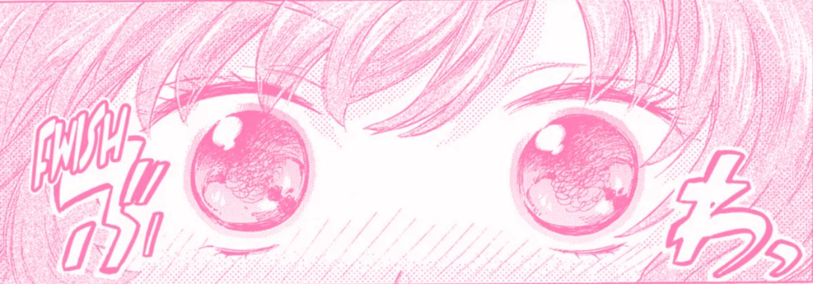

<div align="center">



# 🌸 Koharu (心春)
### *A Cute, Feature-Packed Discord Community & Custom Role Engine*

[](https://nodejs.org)
[](https://discord.js.org)
[](https://github.com/WiseLibs/better-sqlite3)
[](LICENSE)
[](.github/workflows/ci.yml)

<p align="center">
  <b>Koharu</b> brings a heartwarming anime aesthetic to your Discord server with interactive custom role management, dual-gradient booster perks, essential moderation tooling, a cozy part-time job economy, button-driven Blackjack, and administrative event keys.
</p>

[Key Features](#-key-features) • [Role System](#-custom-role-system) • [Moderation](#-moderation-suite) • [Economy & Casino](#-economy--casino) • [Quick Start](#-quick-start) • [Command Reference](#-command-reference)

---

</div>

## ✨ Key Features

- 🎨 **Interactive Custom Role Panel**: Deploy a persistent embed with a one-click `[ Configure Role ]` button. Users can customize their role name, hex color, and icon through native Discord modals.
- 🚀 **Nitro Booster Gradient Perks**: Server boosters unlock dual-color gradient roles (e.g. `#F472B6, #A78BFA`) and enjoy free role updates without spending coins.
- 🛡️ **Essential Moderation Suite**: Clean, hierarchy-safe moderation tools (`/ban`, `/kick`, `/timeout`, `/untimeout`, `/purge`, `/slowmode`, `/warn`) with polite DM infractions.
- 🪙 **Cozy Anime Economy**: 15+ cute part-time job shifts (`-work` / `/work`) at maid cafés, anime bookstores, and cat cafés with dynamic cooldowns.
- 🏦 **Secure Banking & Leaderboards**: Keep coins safe with deposit/withdrawal commands (`-dep all`, `-with all`) and compete for top server wealth rankings.
- 🃏 **Button-Driven Blackjack**: High-stakes casino action with interactive `[ Hit ]`, `[ Stand ]`, and `[ Double Down ]` buttons, soft-Ace handling, and natural 3:2 payouts.
- 🔑 **Administrative Event Keys**: Issue exclusive non-transferable `Event Keys` to tournament winners, event participants, or VIPs for role purchases.
- ⚡ **Dual Command Interface**: Full support for modern Discord Slash Commands (`/`) and classic chat prefixes (`-`).
- 🛡️ **Zero-Config WAL Database**: Built on `better-sqlite3` with Write-Ahead Logging for ultra-fast local persistence with zero external service dependencies.

---

## 🎨 Custom Role System

Koharu eliminates messy role permissions by giving administrators complete control over automated role creation and hierarchy positioning.

```text
┌─────────────────────────────────────────────────────────────────────────────┐
│ 🌸 Koharu [APP]                                                             │
│ ┌─────────────────────────────────────────────────────────────────────────┐ │
│ │ 🎨 Custom Role Management                                               │ │
│ │                                                                         │ │
│ │ Manage your personalized role with our server's role features. Create,  │ │
│ │ customize, and maintain your role identity directly from this panel.   │ │
│ │                                                                         │ │
│ │ 🪙 Cost per Role:                      ❓ How it Works:                 │ │
│ │ • Coins: 25,000 coins                  1. Click [ Configure Role ]      │ │
│ │ • Event Keys: 1 🔑                      2. Enter role name & hex color   │ │
│ │ • Boosters: 100% Free ✨               3. Role is created & synced!     │ │
│ └─────────────────────────────────────────────────────────────────────────┘ │
│ [ 🎨 Configure Role ]                                                       │
└─────────────────────────────────────────────────────────────────────────────┘
```

### 1. Panel Deployment
Administrators can deploy the interactive management panel to any channel with:
```bash
/rolepanel setup #channel: #custom-roles
```

### 2. Member Experience
1. The member clicks **`🎨 Configure Role`**.
2. A native Discord modal prompts them for:
   - **Role Name**: Up to 32 characters (e.g., `🌸 Sakura Blossom`).
   - **Hex Color**: Standard 6-character hex code (`#F472B6`).
   - **Booster Perks**: If the member is boosting the server, they can input two hex codes separated by a comma (`#F472B6, #A78BFA`) to unlock a blended gradient role!
   - **Payment Method**: Select whether to pay using `coins` or `key`. Boosters are automatically granted free creation.
3. Koharu positions the created role right below your server's designated anchor role, assigns it to the user, and presents an embed confirmation with color swatch previews.

---

## 🛡️ Moderation Suite

Keep your community safe with clean, hierarchy-safe moderation tools featuring automatic DM notices to users and zero chat clutter.

- **`/ban <user> [reason] [delete_days]`**: Permanently ban members with optional message history cleanup (0-7 days).
- **`/kick <user> [reason]`**: Remove disruptive members with direct message explanations.
- **`/timeout <user> <duration> [reason]`**: Temporarily mute/isolate members using human durations (`10m`, `2h`, `1d`, `7d`).
- **`/untimeout <user>`**: Instantly restore speaking privileges.
- **`/purge <amount> [user]`**: Bulk delete up to 100 messages with 4-second auto-deleting confirmation.
- **`/slowmode <seconds>`**: Adjust channel message cooldowns (0 to 6 hours).
- **`/warn <add|list|clear> <user>`**: Issue formal infractions, view history timestamps, or clear clean slates.

---

## 🪙 Economy & Casino

### Cozy Part-Time Jobs
Earn coins by helping out around town:
- *"Worked a quiet afternoon shift at the cat café serving strawberry matcha lattes (+320 🪙)"*
- *"Assisted a mangaka by adding screen tones and inking background panels (+410 🪙)"*
- *"Whipped up fluffy souffle pancakes at an anime maid café (+295 🪙)"*

```
Default Cooldown: 5 minutes (configurable in .env)
Payout Range: 150 - 500+ coins
```

### Interactive Blackjack (`-bj <amount>`)
Play classic casino Blackjack right inside your chat channels:
- Natural Blackjack pays **3:2**.
- Standard dealer rule: dealer hits on soft 16, stands on 17+.
- **Double Down** option available on initial 2 cards for double the bet.

---

## 🚀 Quick Start

### Prerequisites
- [Node.js](https://nodejs.org) **v20.0.0** or newer.
- A Discord Bot Token from the [Discord Developer Portal](https://discord.com/developers/applications).

### 1. Clone the Repository
```bash
git clone https://github.com/iriss-dev/koharu.git
cd koharu
```

### 2. Install Dependencies
```bash
npm install
```

### 3. Configure Environment Variables
Copy `.env.example` to `.env` and fill in your credentials:
```bash
cp .env.example .env
```

```ini
# Discord Application Credentials
DISCORD_TOKEN=your_bot_token_here
CLIENT_ID=your_client_application_id_here

# Prefix for text commands (default: -)
DEFAULT_PREFIX=-

# Custom Role System Defaults
DEFAULT_ROLE_COST_COINS=25000
DEFAULT_ROLE_COST_KEYS=1
BOOSTER_ROLE_FREE=true
BOOSTER_DUAL_COLOR=true

# Economy Configuration
WORK_COOLDOWN_SECONDS=300
WORK_MIN_PAYOUT=150
WORK_MAX_PAYOUT=500
```

### 4. Bot Permissions & Intents
Ensure your bot application has the following **Privileged Gateway Intents** toggled ON in the Developer Portal:
- `Server Members Intent` (`GUILD_MEMBERS`)
- `Message Content Intent` (`MESSAGE_CONTENT`)

In your server's role list, make sure **Koharu's role is placed ABOVE** the roles it is meant to manage!

### 5. Start the Bot
```bash
# Production mode
npm start

# Development mode with hot-reloading
npm run dev

# Run unit tests
npm test
```

---

## 📖 Command Reference

### 🎨 Custom Roles
| Command | Prefix | Description | Required Permissions |
| :--- | :--- | :--- | :--- |
| `/rolepanel setup` | `-rolepanel setup` | Deploy the persistent role configuration embed. | `Manage Roles` |
| `/rolepanel config` | — | Modify role pricing, anchor position, and booster rules. | `Manage Roles` |

### 🛡️ Moderation Tools
| Command | Prefix | Description | Required Permissions |
| :--- | :--- | :--- | :--- |
| `/ban <user> [reason]` | `-ban <user>` | Permanently ban an abusive member. | `Ban Members` |
| `/kick <user> [reason]` | `-kick <user>` | Kick a member from the server. | `Kick Members` |
| `/timeout <user> <time>` | `-timeout <user>` | Isolate member (e.g. `10m`, `1h`, `1d`). | `Moderate Members` |
| `/untimeout <user>` | `-untimeout <user>`| Remove active timeout. | `Moderate Members` |
| `/purge <amount> [@user]`| `-purge <amount>` | Bulk delete messages (1-100). | `Manage Messages` |
| `/slowmode <seconds>` | `-slowmode <sec>` | Adjust chat cooldown (0 to disable). | `Manage Channels` |
| `/warn <add\|list\|clear>`| `-warn`, `-warnings`| Manage warnings & infraction records. | `Moderate Members` |

### 🪙 Economy & Banking
| Command | Prefix | Description |
| :--- | :--- | :--- |
| `/work` | `-work`, `-job` | Work a part-time job shift for coins (5m cooldown). |
| `/balance` | `-bal`, `-money` | Check your coins, bank savings, and event keys. |
| `/deposit <amount>` | `-dep <amount\|all>` | Store wallet coins in your bank account. |
| `/withdraw <amount>` | `-with <amount\|all>` | Withdraw coins from your bank to your wallet. |
| `/leaderboard` | `-lb`, `-top` | View top richest server members. |

### 🃏 Casino Mini-Games
| Command | Prefix | Description |
| :--- | :--- | :--- |
| `/blackjack <bet>` | `-bj <amount\|all>` | Play interactive Blackjack against the dealer. |

### 🔑 Administration & Keys
| Command | Prefix | Description | Required Permissions |
| :--- | :--- | :--- | :--- |
| `/keys grant <@user> <amt>` | `-keys grant <@user> <amt>` | Award Event Keys to a member. | `Manage Server` |
| `/keys revoke <@user> <amt>`| `-keys revoke <@user> <amt>`| Revoke Event Keys from a member. | `Manage Server` |
| `/keys check <@user>` | `-keys check <@user>` | Inspect a member's Event Key balance. | None |

---

## 🛠️ Tech Stack & Architecture

- **Runtime**: Node.js v20+
- **Library**: [discord.js v14](https://discord.js.org/)
- **Database**: [better-sqlite3](https://github.com/WiseLibs/better-sqlite3) (Zero-dependency SQLite WAL)
- **Architecture**:
  ```
  koharu/
  ├── assets/                # Banners, preview screenshots, and mascots
  ├── src/
  │   ├── commands/          # Modular command controllers
  │   │   ├── economy/       # work, balance, deposit, withdraw, blackjack, keys, lb
  │   │   ├── roles/         # rolepanel, rolehandler (buttons & modals)
  │   │   └── general/       # help
  │   ├── database/          # SQLite schema, migrations, prepared statements
  │   ├── events/            # Discord gateway event handlers
  │   ├── utils/             # Embed builders, cards engine, hex color interpolators
  │   ├── config.js          # Central runtime configuration
  │   └── index.js           # Client gateway bootstrapper
  ├── test/                  # Node.js built-in unit test suite
  └── .github/workflows/     # CI workflow for Automated Testing
  ```

---

## 🤝 Contributing

Contributions are welcome! Please feel free to submit a Pull Request. For major changes, please open an issue first to discuss what you would like to change.

1. Fork the Project
2. Create your Feature Branch (`git checkout -b feature/AmazingFeature`)
3. Commit your Changes (`git commit -m 'Add some AmazingFeature'`)
4. Push to the Branch (`git push origin feature/AmazingFeature`)
5. Open a Pull Request

---

## 📄 License

Distributed under the **GNU General Public License v3.0**. See [`LICENSE`](LICENSE) for more details.

---

<div align="center">
  <sub>Crafted with 🌸 by <a href="https://github.com/iriss-dev">Iris</a> for cozy anime & community servers.</sub>
</div>
