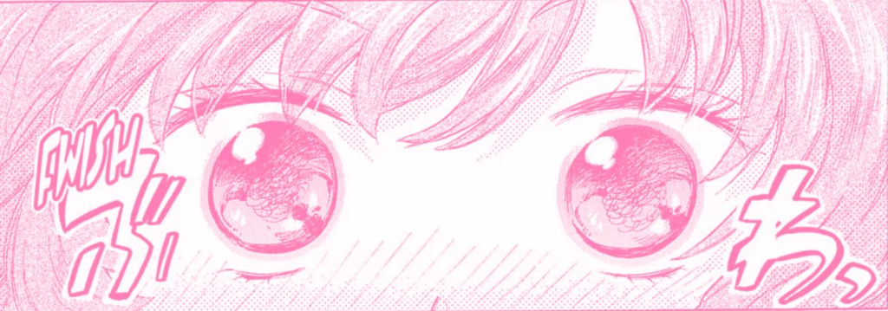
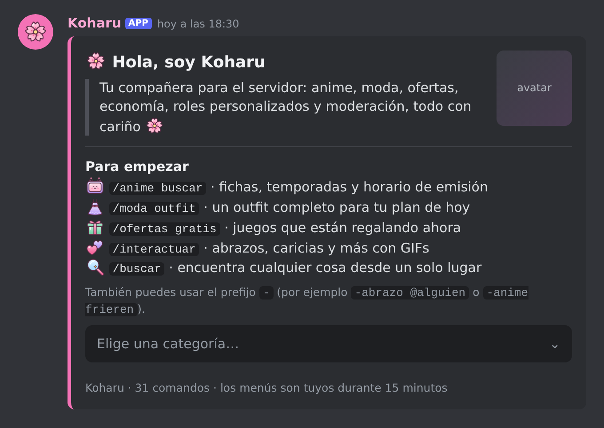
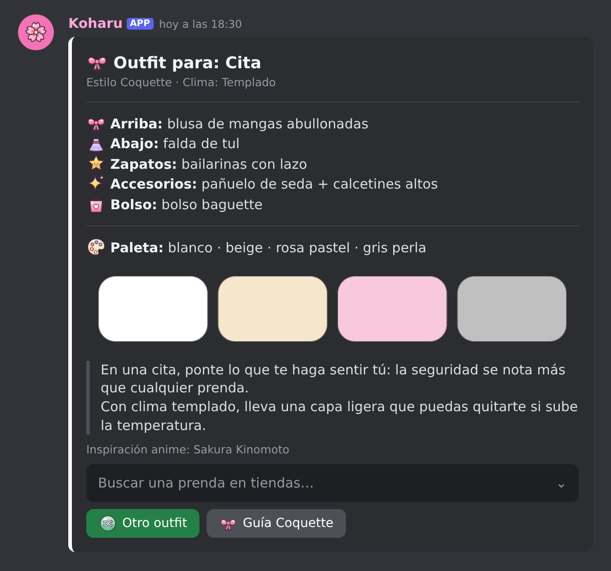
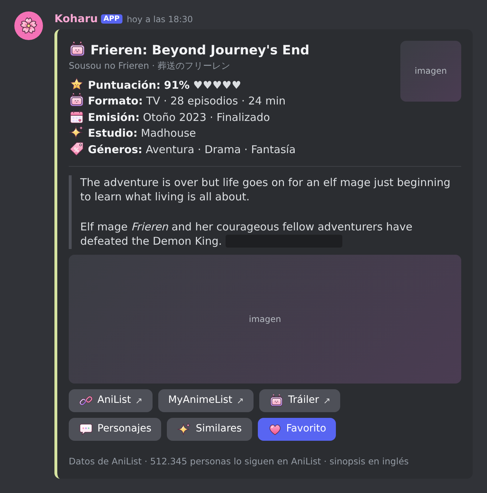
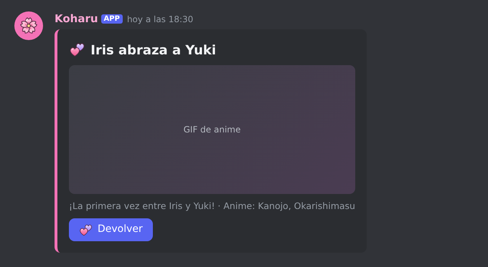
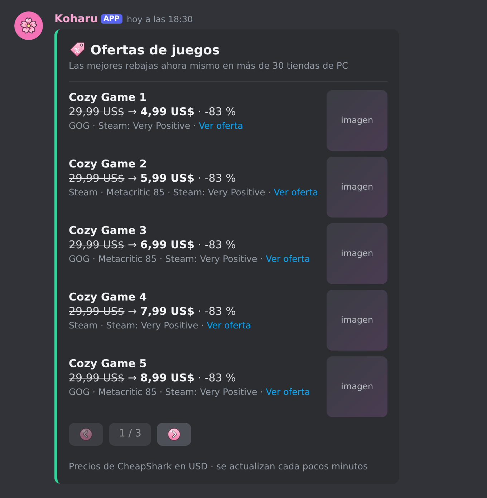
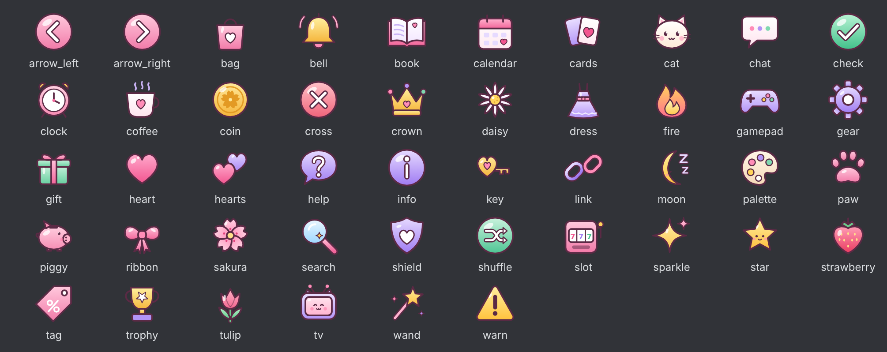

<div align="center">



# Koharu (心春)

**A cute, bilingual Discord companion for anime and fashion communities.**
Anime & manga lookups · fashion help · game deals · anime interactions · economy · custom gradient roles · moderation

[](https://github.com/iriss-dev/koharu/actions/workflows/ci.yml)
[](https://nodejs.org)
[](https://discord.js.org)
[](LICENSE)

🇪🇸 Koharu habla español e inglés: responde en el idioma de cada persona, o en el que elija el servidor.

</div>

---

<table>
  <tr>
    <td width="50%"></td>
    <td width="50%"></td>
  </tr>
  <tr>
    <td></td>
    <td><br /></td>
  </tr>
</table>

<sub>Previews rendered from Koharu's real replies with <code>npm run preview</code>. They run offline, so remote images (covers, GIFs, avatars) appear as grey placeholders.</sub>

## What Koharu does

### 🔎 One search for everything
`/buscar` (`/search`) looks through anime, manga, characters, fashion, game deals and Koharu's own commands at once, with suggestions while you type. Pick any result to open its full card.

### 📺 Anime & manga (AniList)
| Command | What you get |
| --- | --- |
| `/anime buscar` | Full card: score, format, season, studio, next episode, genres, synopsis with spoilers hidden, banner, trailer and links |
| `/anime temporada` · `/anime tendencias` | The season's or the week's most popular titles, with covers and pages |
| `/anime horario` | Upcoming episodes in **your** timezone (next 24 h, 24–48 h or 7 days) |
| `/anime azar` · `/anime similares` | A random well-rated title (optionally by genre) or recommendations from one you liked |
| `/manga` · `/personaje` | Manga, light novels and characters |

Every card has **Characters**, **Similar** and **♥ Favourite** buttons; favourites appear on your `/perfil`. Adult titles are always filtered out.

### 👗 Fashion help
| Command | What you get |
| --- | --- |
| `/moda outfit` | A complete outfit for the occasion (date, office, class, wedding guest, party, gym, beach…) and the weather, in a style that fits or the one you choose, with its colour palette as an image |
| `/moda estilo` | Guides to 12 aesthetics: kawaii, coquette, clean girl, streetwear, Y2K, dark academia, cottagecore, old money, gothic, boho, athleisure, e-girl |
| `/moda colores` | What goes with a colour (code or name, e.g. `lavanda`): monochrome, analogous, complementary, triadic and the neutrals that always work |
| `/moda colorimetría` | Your colour season from undertone, hair and eyes: your colours, neutrals, metal and what to use with care |
| `/moda tip` | Practical tips on combining colours, fit, basics, clothing care, accessories and smart shopping |

The outfit generator draws from 110 tagged pieces and never returns an incomplete look. **Find this piece** builds ready-made searches on Pinterest, Google Shopping, Amazon and SHEIN. They are plain searches, not affiliate links.

### 🎁 Deals
| Command | What you get |
| --- | --- |
| `/ofertas juegos` | The best PC game discounts across 30+ stores (Steam, GOG, Humble, Fanatical, Epic…), filterable by title, price and store |
| `/ofertas gratis` | Games, DLC and betas being given away right now, by platform |
| `/ofertas alerta` | A private message when a game drops to your price |
| `/ofertas canal` | Koharu posts every new free game in a channel automatically |

### 💞 Interactions
`/interactuar` (or `-abrazo @alguien`, `-pat`, `-besito`…) with 19 actions and `/reaccionar` with 20 reactions, each with an anime GIF. Koharu counts every pair ("Hugs from Iris to Yuki: **5**"), and the person on the receiving end gets a **Return it** button.

### 🪙 Economy & casino (per server)
`/trabajar` (17 cosy jobs) · `/diario` with streaks and a weekly bonus · `/saldo` with quick buttons · `/depositar` · `/retirar` · `/pagar` · `/ranking` · `/perfil` with bio, style and favourites · `/llaves` (event keys) · `/blackjack` (dealer peek, 3:2, double, idle timeout) · `/moneda` · `/tragamonedas`

Amounts accept `500`, `2.5k`, `mitad` / `half` and `todo` / `all`. Bets are taken atomically, so a balance can never go negative.

### 🎨 Custom roles
`/panelroles publicar` posts a panel. Members press **Set up role**, choose a name, a colour (code or name) and how to pay, and see a **preview image** before confirming. Server boosters can use two colours: a **real gradient role** where Discord's enhanced role colours are available, or a blend of both otherwise. If Discord rejects the change, the payment is refunded.

### 🛡️ Moderation
`/banear` · `/expulsar` · `/aislar` · `/desaislar` · `/advertir` · `/limpiar` · `/modolento` with hierarchy checks, a private notice to the member and a copy of every case in the log channel set with `/config registro`.

### ⚙️ Settings
`/config ver | idioma | prefijo | registro` sets the language (automatic, Spanish or English), the text prefix and the moderation log.

## Koharu's own emojis



46 emojis drawn for Koharu with one consistent style. On startup the bot uploads them as **application emojis**: they belong to the bot, work in every server it joins and use none of the server's emoji slots. If an upload fails, Koharu falls back to matching Unicode emojis, so messages never break. The artwork lives as SVG in `scripts/emojis/designs.js`.

## Quick start

1. **Create the application** at the [Discord Developer Portal](https://discord.com/developers/applications) and copy its token and application ID.
2. **Optional:** enable **Message Content Intent** if you want prefix commands like `-abrazo @alguien`.
3. **Invite the bot** (replace `YOUR_ID`):
   ```
   https://discord.com/oauth2/authorize?client_id=YOUR_ID&scope=bot+applications.commands&permissions=1099780451350
   ```
   Place Koharu's role **above** the custom roles it should manage.
4. **Run it:**
   ```bash
   git clone https://github.com/iriss-dev/koharu.git
   cd koharu
   npm install
   cp .env.example .env   # fill in DISCORD_TOKEN and CLIENT_ID
   npm start
   ```

On first start Koharu registers its slash commands and uploads its emojis. Set `DEV_GUILD_ID` while developing so command changes appear instantly in your test server. Every option is documented in [`.env.example`](.env.example).

### Upgrading from 1.x

Nothing to do by hand. The database upgrades itself on start, and each person's old balance and keys move into the first server where they use Koharu, exactly once. Existing custom roles are adopted automatically, and role panels posted by 1.x keep working.

## Data sources

| Service | Used for | Notes |
| --- | --- | --- |
| [AniList](https://anilist.co) | Anime, manga, characters, schedules | Public GraphQL API; synopses are in English as published by AniList |
| [CheapShark](https://www.cheapshark.com) | PC game prices | Prices in USD; links go through CheapShark's redirect as their terms ask |
| [GamerPower](https://www.gamerpower.com) | Free games and loot | |
| [nekos.best](https://nekos.best) | Reaction GIFs | SFW only; interactions still work without a GIF |

All four are free and need no API key. Koharu caches responses and backs off on rate limits.

## Development

```bash
npm test             # 90 tests: every command end to end, Discord payload limits, translations, economy, casino odds
npm run preview      # screenshots of real replies → docs/preview/
npm run emojis:render -- --sheet sheet.png   # re-render the emoji set (needs Playwright)
```

The tests run each command against fake Discord objects and recorded API responses, then check every reply against Discord's Components V2 limits: 40 components, 4000 characters of text, 100-character custom IDs and matching attachments. See [CONTRIBUTING.md](CONTRIBUTING.md) for the code layout.

## License

[GPL-3.0](LICENSE). Made with 🌸 by [Iris](https://github.com/iriss-dev).
